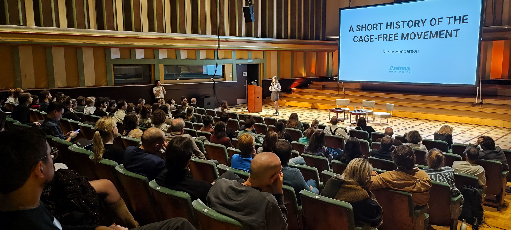

EA Brussels hosts a range of **events and projects** to help people connect, learn, and take action:

- **Meetups and social events** — Casual gatherings to meet like-minded people, discuss ideas, and grow the local community.
- **Talks and workshops** — Sessions with experts on topics like effective giving, EU policy and various EA cause areas.
- **Professional networking** — Connecting people interested in impactful careers, especially in EU institutions, think tanks, NGOs, and academia.

